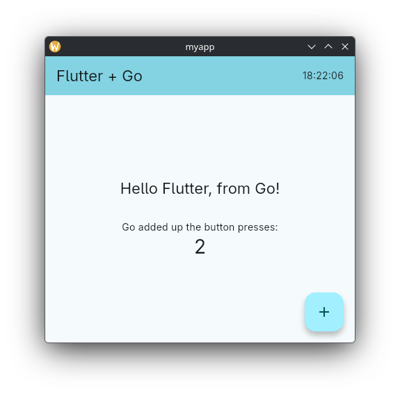

# fluffy - Flutter with Go

> **Transparency note:** This project was built with the help of agentic AI. The base skeleton and prototype were written and built manually by a human, and all source code has been reviewed manually by a human. This does not mean there are no bugs ;-)



Fluffy is a CLI tool, still in development, that integrates Go code into any Flutter (Dart) project. On native targets the Go code is compiled to a C library and called over `dart:ffi`; on the web it runs as WebAssembly. Fluffy hooks into the Flutter build of every native platform, so `flutter run` and `flutter build` compile the Go code automatically (on the web `fluffy run` and `fluffy build` do it), and it generates a typed Dart API from your plain Go functions, services and structs. Underneath, a small message layer carries requests, events and streams in both directions, so Go can call back into Dart as well.

## Requirements
- Flutter 3.16 or newer
- Go 1.25 or newer for the CLI, the generated project needs Go 1.21 or newer (with cgo configured)

## Goals
- Automatic build pipeline for all targets
- Plain Go functions and services callable from Dart with a generated, typed API (see [Generated API](#generated-api))
- A generic communication layer between Dart and Go underneath (see [Communication layer](#communication-layer))

## Supported platforms

| Target | Build integration | Works |
|---------|-------------------|-------|
| windows | :white_check_mark: | :white_check_mark: |
| linux   | :white_check_mark: | :white_check_mark: |
| macos   | :white_check_mark: | :white_check_mark: |
| android | :white_check_mark: | :white_check_mark: |
| ios     | :white_check_mark: | :white_check_mark:[^1] |
| web     | :white_check_mark:[^2] | :white_check_mark: |

*Tested on real devices with Windows 11 26H2, CachyOS, macOS 27 and Android 16*

[^1]: Only tested in the Simulator due to the lack of a real test device.
[^2]: Only possible with the fluffy CLI, because the Flutter web target exposes no build files.

## Getting started

### 1. Install the CLI

First, you need to install a small utility tool. Unfortunately, it is required to apply configuration changes to your project. These changes provide an automatic compilation process for the Go code.

```sh
go install github.com/madzione/fluffy@latest
```

The platform build hooks call `fluffy` during every build, so the install directory (usually `$(go env GOPATH)/bin`, e.g. `~/go/bin`) has to be on your `PATH`. A copy of the binary inside the project is not enough. When the build can't find `fluffy`, it stops with a message saying so. Check it with:

```sh
fluffy --version
```

Besides Flutter and Go you need what cgo needs for your targets:

| Target  | Extra requirement |
|---------|-------------------|
| linux   | a C compiler (`gcc` or `clang`) |
| windows | a C compiler for cgo, e.g. MinGW-w64 (`gcc` on `PATH`) |
| macos / ios | Xcode with command line tools |
| android | Android NDK (install it from the SDK manager) |
| web     | nothing, Go compiles to WebAssembly without cgo |

### 2. Create a runnable app

```sh
fluffy create my_app
cd my_app
```

`fluffy create` runs `flutter create` and then `fluffy init` in the new directory. All flags except `--fvm` and `--patch-gtk` are passed on to `flutter create`; only the **last argument has to be the directory**:

```sh
fluffy create --org com.example --platforms linux,windows,android,web my_app
```

With [FVM](https://fvm.app) installed, the project is created with an FVM-managed Flutter SDK and pinned to it: `my_app/` gets its own `.fvmrc` and `.fvm/`. The version comes from, in this order:

1. `--fvm <version>`, e.g. `fluffy create --fvm 3.24.0 my_app` (a release or a channel like `stable`)
2. the `.fvmrc` in the current directory or a parent (so `fvm use` there works too, and the parent stays untouched)
3. the FVM global version (`fvm global`)

Without any of these, or without FVM, `flutter` from `PATH` is used.

Add `--patch-gtk` to get rid of the thick GTK title bar on Linux desktops other than GNOME (see [Linux window decoration](#linux-window-decoration)):

```sh
fluffy create --patch-gtk my_app
```

Init adds:

```
my_app/
├── golang/
│   ├── go.mod               module my_app/golang
│   ├── api.go               your Go code: functions marked with //fluffy:export
│   ├── main.go              starts the layer on the web, //go:generate fluffy generate
│   ├── fluffy_api.go        generated: registers the exported functions (managed by fluffy)
│   └── fluffy/              the communication layer (managed by fluffy)
│       ├── bridge.go        message protocol, Start
│       ├── emitter.go       Emit, Request
│       ├── receiver.go      On, Handle, Bind, Export, streams
│       ├── transport_cgo.go native transport (cgo exports for dart:ffi)
│       └── transport_js.go  web transport (globalThis.golang)
└── lib/golang/
    ├── golang.dart          import this one
    ├── api.dart             your additions, re-exports api.g.dart
    ├── api.g.dart           generated: the typed Dart API of golang/ (managed by fluffy)
    └── src/                 the communication layer (managed by fluffy)
```

It also patches the build files of every platform the project has (see [Build hooks](#build-hooks)), appends the generated libraries to `.gitignore`, runs `fluffy generate` and runs `flutter pub add ffi`.

### 3. Look at the demo

`fluffy create` replaces Flutter's counter app with a demo that talks to Go:

- The + button counts up with `add`, which runs in Go.
- The greeting comes from Go's `Hello` function, which fails for an empty name.
- The clock in the app bar is a stream: Go's `Clock` returns a channel that gets the time every second.

All three are plain Go functions in `golang/api.go`, their Dart functions are generated into `lib/golang/api.g.dart`.

`test/widget_test.dart` is replaced too. It tests the demo against a fake Go side, so `flutter test` works without building the Go library.

`fluffy init` in an existing project leaves `lib/main.dart` alone. Call Go from anywhere in the app with:

```dart
import 'package:my_app/golang/golang.dart' as golang;

final sum = await golang.add(2, 3); // 5
```

### 4. Run it

```sh
fluffy run                 # flutter picks the device
fluffy run -d linux        # or windows, macos, <android device id>, ...
fluffy run -d chrome       # web
```

`fluffy run` first runs `fluffy generate`, so the Dart API matches the Go code. On native targets the Go library is compiled by the platform build hook, so a plain `flutter run` works just as well once the API is generated. Web has no build hook in Flutter: `fluffy run` builds `web/golang.wasm` first when the device may be a browser (`-d chrome`, `-d edge`, `-d web-server`, or no `-d` at all in a project with a `web/` folder). For a release build run `fluffy build`, which generates first, builds `web/golang.wasm` for web (stripped, unless `--debug` or `--profile`) and then runs `flutter build` with the same arguments:

```sh
fluffy build web
fluffy build apk
```

### 5. Add your own Go functions

1. Write a Go function anywhere in `golang/` and mark it with `//fluffy:export`:

   ```go
   // Greet greets everyone in names.
   //
   //fluffy:export
   func Greet(names []string) (string, error) { ... }
   ```

2. Run `fluffy generate` (or just `fluffy run`, which does it for you).
3. Call it from Dart: `await golang.greet(['Ada', 'Grace'])`.

No cgo, no separate web code and no hand-written Dart wrapper are needed. See [Generated API](#generated-api) for what Go code turns into which Dart code, including services with state and Go calling Dart.

Your files (`golang/api.go`, `golang/main.go`, `golang/go.mod`, `lib/golang/api.dart`, `lib/golang/golang.dart`) belong to you after the first run; `fluffy init` never overwrites them.

The generated files `golang/fluffy_api.go` and `lib/golang/api.g.dart` belong to fluffy. `fluffy generate` overwrites them, so don't edit them. Commit them, so the Dart code compiles right after a checkout, e.g. for `flutter analyze` in CI.

The communication layer in `golang/fluffy/` and `lib/golang/src/` belongs to fluffy. `fluffy init` and `fluffy update` replace these two directories with the version of the installed fluffy:

- Changed files are overwritten.
- New files are added.
- Files the current version no longer has are deleted.

So don't edit or add files there; your changes would be lost on the next update.

After upgrading fluffy, run `fluffy update` to bring the communication layer, the build hooks and the generated API up to date without touching your code. Projects set up before the generator existed get a hint that `lib/golang/api.dart` should `export 'api.g.dart';`.

## Examples

The [`examples/`](examples) directory holds complete apps created with `fluffy create`:

| Example | Shows |
|---------|-------|
| [`todo`](examples/todo) | A Go service with state bound with `fluffy.Start` / `fluffy.Bind`, a stream, Go calling Dart through a `//fluffy:dart` interface, a widget test against `Bridge.fake()` and an integration test against the real Go library. |
| [`todo_module`](examples/todo_module) | The same app with the service in its own Go module (`todo_module/todo`), pulled in with `require` + `replace`. |
| [`roundtrip`](examples/roundtrip) | Checks that every kind of type, JSON edge case (large integers, `-0`, NaN, invalid UTF-8, nanosecond times), error, panic, stream cancel and Go → Dart call survives the trip, natively and on the web. Doubles as fluffy's regression test, and lists the known limitations. |
| [`mandelbrot`](examples/mandelbrot) | Heavy work in Go: worker goroutines stream image tiles with progress, every view change cancels the running render, and a benchmark tab measures the bridge's latency and throughput. Shows why long Go computations on the web need to yield. |

To run one, install fluffy and start it from the example's directory:

```sh
cd examples/todo
fluffy run
```

## Agent skill

[`skills/fluffy/SKILL.md`](skills/fluffy/SKILL.md) is an [agent skill](https://docs.claude.com/en/docs/claude-code/skills) that teaches coding agents like Claude Code how to work in a fluffy project: the commands, which files are generated or owned by fluffy, how Go turns into Dart, testing and the usual pitfalls. Install it for all your projects:

```sh
mkdir -p ~/.claude/skills/fluffy
curl -fsSL https://raw.githubusercontent.com/madzione/fluffy/main/skills/fluffy/SKILL.md -o ~/.claude/skills/fluffy/SKILL.md
```

or for one project (commit it so everyone working on the app gets it) by putting it into `.claude/skills/fluffy/SKILL.md` instead. Other agents that support skills read the same file from their own skills directory.

## Generated API

`fluffy generate` reads the Go code and writes the Dart side of it, so Go and Dart can't drift apart. The Go signatures are the schema: there is no extra schema file. Channel names, argument shapes and types are checked when Dart compiles, not when a message fails at runtime.

The generator type-checks `golang/` and every package it imports from your own modules: the main module, modules in a `go.work` and modules `replace`d by a local directory. Packages from the module cache and the standard library are only used for their types. Your Go code has to compile, for the web target (`GOOS=js GOARCH=wasm`), so files with `//go:build !js` are left out: `fluffy generate` warns when such a file uses the fluffy API, because its functions and channels are missing from the generated code.

```sh
fluffy generate            # write golang/fluffy_api.go and lib/golang/api.g.dart
fluffy generate --check    # fail if they are out of date, e.g. in CI
fluffy generate --watch    # generate again whenever a Go file, go.mod or go.work changes
```

It runs automatically in `fluffy run`, `fluffy build`, `fluffy init` and `fluffy update`, and through `go generate` (`golang/main.go` has `//go:generate fluffy generate`). The native build hooks don't run it: Flutter compiles the Dart code alongside them, so a Dart file written there may not be picked up. With a plain `flutter run`, keep `fluffy generate --watch` running. When the Go build in a hook fails because `golang/fluffy_api.go` still registers a function you removed or renamed, the hook writes the Go file again and retries; run `fluffy generate` for the Dart side.

### Functions

Mark a function with `//fluffy:export`:

```go
// Add adds a and b.
//
//fluffy:export
func Add(a, b int64) int64 { return a + b }

//fluffy:export
func FindUser(ctx context.Context, id string) (*User, error) { ... }

//fluffy:export
func Clock(ctx context.Context) <-chan string { ... }
```

```dart
Future<int> add(int a, int b);
Future<User?> findUser(String id);
Stream<String> clock();
```

A function can have:

- **Parameters:** an optional `context.Context` first, then any number of arguments. Variadic functions aren't supported.
- **Results:** nothing, `R`, `error` or `(R, error)`. An error fails the Dart future with a `GolangException`, nothing or only `error` gives a `Future<void>`.
- **A channel result** (`<-chan T`, optionally with an `error`): the Dart function returns a `Stream<T>`. Go calls the function when Dart starts listening and sends every value until the channel is closed. When Dart cancels the subscription, the function's `ctx` is cancelled, so the goroutine can stop. Close the channel when you stop, also on `ctx.Done()`. Values sent after the cancel are drained, so a sender that ignores `ctx` doesn't block forever, but only until the channel is closed or idle for 5 seconds. There is no backpressure: Go sends as fast as the channel delivers, and Dart buffers what a paused or slow listener hasn't handled yet, so pace fast producers yourself.

The `ctx` of other functions is never cancelled. Go doc comments become Dart doc comments.

Functions in `golang/` can be unexported, functions in other packages have to be exported. A function in another package is reached through its package name: `todo.Version` becomes `golang.todo.version()`.

### Services with state: `fluffy.Start` and `fluffy.Bind`

An existing Go app usually has its API as methods on services that hold state, like a database. Bind them instead of exporting functions; the app's packages don't import fluffy:

```go
// github.com/me/todo, an existing app that knows nothing about fluffy
type Service struct{ db *sql.DB }

func NewService(db *sql.DB) *Service { ... }

func (s *Service) Add(ctx context.Context, title string) (*Item, error) { ... }
func (s *Service) List(ctx context.Context) ([]Item, error)            { ... }
```

```go
// golang/main.go
func init() {
	fluffy.Start(func() error {
		db, err := sql.Open("sqlite", "todo.db")
		if err != nil {
			return err
		}
		fluffy.Bind("todo", todo.NewService(db))
		return nil
	})
}
```

```dart
await golang.todo.add('Milk');
final items = await golang.todo.list(); // List<Item>
```

- **`fluffy.Start(fn)`** runs `fn` once, when Dart connects for the first time. On native platforms the Go code is a library whose `main` never runs, so setup goes here. Messages from Dart wait until `fn` has returned, so everything it binds exists before the first request. If `fn` fails, every request fails with its error, so Dart sees why. A hot restart doesn't run it again. Call `Start` from an `init` function.
- **`fluffy.Bind(namespace, impl)`** registers every exported method of `impl` with a supported signature (the same rules as for functions) as the channel `<namespace>.<Method>`. It works by reflection, without the generator. Methods with other signatures are skipped, and `fluffy generate` warns about them.
- **Narrowing what's exposed:** pass an interface as the type argument. `fluffy.Bind[todo.API]("todo", svc)` binds only the methods of `todo.API`.
- In Dart, each namespace is a class (`GoTodo`) reached through a constant (`golang.todo`).

An app in its own module needs `require github.com/me/todo` plus a `replace` to its local path in `golang/go.mod`, or a `go.work`, so the generator scans it.

### Go calling Dart: `//fluffy:dart`

Declare the calls Go makes to Dart as an interface:

```go
//fluffy:dart
type UI interface {
	Confirm(ctx context.Context, question string) (bool, error) // a request, waits for Dart
	Progress(percent float64)                                    // an emit, doesn't wait
}
```

A method has an optional `context.Context` first, then any arguments, and returns nothing (an emit), `error` or `(R, error)` (a request; without a `ctx` it waits forever).

The generator writes a constructor into `golang/fluffy_api.go`, `newUI()` (or `new<Package><Name>()` for interfaces in other packages), whose result forwards every call to Dart. Inject it like any other dependency:

```go
fluffy.Bind("counter", &Counter{ui: newUI()})
```

In Dart, the interface is an abstract class to implement and register. It won't compile until every method is implemented:

```dart
class AppUI implements golang.UI {
  @override
  Future<bool> confirm(String question) => showConfirmDialog(question);

  @override
  void progress(double percent) => print('$percent %');
}

golang.UI.register(AppUI());
```

The interface can live in your app's package too, so it stays testable without Flutter and still doesn't import fluffy.

### Type mapping

| Go | Dart |
|---|---|
| `int*`, `uint*` | `int` (on the web, values above 2⁵³ lose precision) |
| `float*` | `double` |
| `string`, `bool` | `String`, `bool` |
| `[]byte` | `Uint8List` (base64 on the wire, converted for you) |
| `[]T`, `[N]T` | `List<T>` (a `nil` slice arrives as an empty list) |
| `map[string]T`, `map[int]T` | `Map<String, T>`, `Map<int, T>` |
| `*T`, fields with `omitempty` (except structs) or `omitzero` | `T?` |
| struct | a generated class with `fromJson`/`toJson`, following `json` tags, `,string` and embedded structs like `encoding/json` |
| `time.Time` | `DateTime` (RFC 3339) |
| `time.Duration` | `Duration` |
| types with `MarshalText` | `String` |
| `any`, interfaces, types with `MarshalJSON` | `Object?` |

Like `encoding/json`, a `MarshalJSON` or `MarshalText` method with a pointer receiver only counts where Go can take the value's address: behind a pointer, in a slice, and when Go decodes. A `Level` with `func (*Level) MarshalText` returned as `Level` is sent as a struct, returned as `*Level` as a string. A struct that contains such a type and is sent both ways fails to generate. Give these methods a value receiver.
| `<-chan T` result | `Stream<T>` |
| `error` result | throws `GolangException` |
| channels as data, funcs, complex numbers | not supported, `fluffy generate` fails |

A struct gets one class however often it is used. If two packages have a struct with the same name, the second class gets the package name as a prefix.

### Channels you register yourself

The generator also writes typed functions for the [communication layer](#communication-layer) calls it finds, as long as the channel name is a constant:

| Go | Generated Dart |
|---|---|
| `fluffy.Handle[T, R]("add", fn)` | `Future<R> add(T data)` |
| `fluffy.On[T]("log", fn)` | `void log(T data)` |
| `fluffy.Emit("tick", data)` | `Stream<T> tick()` (or `onTick()` if Go also handles `"tick"`) |
| `fluffy.Request[R](ctx, "confirm", data)` | `void handleConfirm(FutureOr<R> Function(T data) handler)` |

A channel name with dots, like `"todo.progress"`, goes into the namespace class: `golang.todo.progress()`. A `struct{}` argument becomes a function without parameters.

### Conflicts

`fluffy generate` fails where the runtime would silently do the wrong thing:

- a channel registered twice (the second registration would replace the first),
- a channel sent with different types, or sent from Go and handled in Go with different types,
- two channels, namespaces or interfaces that end up with the same Dart name,
- unsupported types in exported functions, explicit channels and `//fluffy:dart` interfaces,
- a struct that `encoding/json` encodes differently as a value and through a pointer (see the type table).

It warns about channels that aren't constants (they are left out), skipped `Bind` methods, unknown `//fluffy:` directives, `//fluffy:export` and `//fluffy:dart` lines that aren't attached to a declaration (a blank line between the comment and the `func` detaches it), and files outside the web build that use the fluffy API.

## Communication layer

The [generated API](#generated-api) is built on this layer, and you can use it directly too. Dart and Go exchange messages on named **channels**, for example `"add"`. The API is the same on both sides and works in both directions:

- **Emitter:** sends messages.
- **Receiver:** gets messages through the handlers you register on it.

| | Go (`<module>/golang/fluffy`) | Dart (`golang.dart`) |
|---|---|---|
| Send, no answer | `fluffy.Emit(channel, data)` | `emitter.emit(channel, data)` |
| Send and wait for the answer | `fluffy.Request[R](ctx, channel, data)` | `emitter.request<T>(channel, data)` |
| Get sent messages | `fluffy.On[T](channel, func(T))` | `receiver.on<T>(channel)`, a `Stream<T>` |
| Answer requests | `fluffy.Handle[T, R](channel, func(T) (R, error))` | `receiver.handle(channel, handler)` |
| Remove a handler | `fluffy.Remove(channel)` | `receiver.remove(channel)` |
| Listen to a stream | function with a `<-chan T` result, via `Export` or `Bind` | `emitter.subscribe(channel, args)` |
| Register functions | `fluffy.Export(channel, fn)`, `fluffy.Bind(namespace, impl)` | |

Data is encoded as JSON:

- **Go:** use any type `encoding/json` can handle. Structs with `json` tags work well.
- **Dart:** use `null`, `bool`, `num`, `String`, or `List`s and `Map<String, …>`s of these.

### Dart asks, Go answers

The demo's `add`. Go registers a handler in `golang/api.go`:

```go
type addRequest struct {
	A int64 `json:"a"`
	B int64 `json:"b"`
}

func init() {
	fluffy.Handle("add", func(req addRequest) (int64, error) {
		return req.A + req.B, nil
	})
}
```

`fluffy generate` turns this into `Future<int> add(AddRequest req)` with an `AddRequest` class. Without the generator, Dart calls it like this:

```dart
final sum = await emitter.request<int>('add', {'a': 2, 'b': 3});
```

Register handlers in an `init()` function or a `fluffy.Start` function. On native platforms the Go code is loaded as a library and `main` never runs.

**Errors:** a Go handler that returns an error or panics fails the Dart future with a `GolangException`. So does a request on a channel that has no Go handler:

```dart
try {
  await golang.hello('');
} on golang.GolangException catch (e) {
  print(e.message); // name is empty
}
```

**Typed results:** `request<T>` gives back the decoded JSON as it is, so `T` is `int`, `double`, `String`, `bool`, `Map<String, dynamic>` or `List<dynamic>`. Convert anything else yourself, e.g. `(await emitter.request<List<dynamic>>('ids')).cast<int>()`, or let the generator do it.

### Bytes and images

`encoding/json` sends a `[]byte` as a base64 string. Return the bytes from the handler, here a PNG embedded in the Go library. The request carries no data, so the handler takes an empty `struct{}`:

```go
//go:embed gopher.png
var gopher []byte

func init() {
	fluffy.Handle("gopher", func(struct{}) ([]byte, error) {
		return gopher, nil
	})
}
```

The generated `Future<Uint8List> gopher()` decodes the base64 string back into bytes. By hand, that is:

```dart
final bytes = base64Decode(await emitter.request<String>('gopher'));
```

The bytes work with anything that takes a `Uint8List`, e.g. as an image:

```dart
final bytes = await golang.gopher();
setState(() => _image = MemoryImage(bytes));

Image(image: _image, gaplessPlayback: true)
```

Bytes from Dart to Go work the same way: send `base64Encode(bytes)` and take a `[]byte` in the Go handler, which `encoding/json` decodes from base64.

The answer is a copy, so there is no C memory to free on the Dart side. Base64 makes the message about a third larger, which is fine for images and files, but not for large data sent many times per second.

### Go sends events to Dart

Go emits to a channel whenever it likes. Unlike a function with a channel result (a [stream](#functions)), the emit goes to every listener and Go doesn't know whether anyone listens:

```go
go func() {
	for now := range time.Tick(time.Second) {
		fluffy.Emit("clock", now.Format("15:04:05"))
	}
}()
```

Dart listens to it as a stream, through the generated `clock()` or `receiver.on`:

```dart
Stream<String> clock() => receiver.on<String>('clock');

StreamBuilder<String>(
  stream: golang.clock(),
  builder: (context, snapshot) => Text(snapshot.data ?? ''),
)
```

Messages Go emits before Dart has connected are kept and delivered once it connects, up to 1024. Dart connects the first time the app uses `emitter` or `receiver`. Emits on a channel nobody listens to are dropped.

### Dart sends events to Go

```go
fluffy.On("log", func(line string) {
	log.Println("from Dart:", line)
})
```

```dart
golang.emitter.emit('log', 'button pressed');
```

### Go asks, Dart answers

```dart
golang.receiver.handle('confirm', (data) async {
  final question = data as String;
  return await showConfirmDialog(question); // any JSON value, or throw to fail
});
```

```go
ctx, cancel := context.WithTimeout(context.Background(), time.Minute)
defer cancel()
ok, err := fluffy.Request[bool](ctx, "confirm", "Delete all files?")
```

`Request` blocks the calling goroutine until Dart answers or `ctx` ends. If the Dart handler throws, `err` is a `*fluffy.DartError`.

### Concurrency

- **Go:** every incoming message is handled in its own goroutine, like `net/http`. Handlers never block Dart, and they can call `Request` themselves.
- **Dart:** handlers and stream listeners run on the main isolate.

### Testing

**Dart:** widget tests run without the Go library. `Bridge.fake()` connects the app to an in-memory bridge that plays the Go side. Exported functions and bound methods get their arguments as a list, streams are served with `receiver.stream`:

```dart
final go = golang.Bridge.fake();
go.receiver.handle('Add', (data) {
  final [a, b] = data as List<dynamic>;
  return (a as int) + (b as int);
});
go.receiver.stream('Clock', (_) => Stream.value('12:00:00'));
```

**Go:** exported functions and services are plain Go and can be tested directly. The layer itself is tested in the fluffy repository, so `go test ./...` in `golang/` only runs your tests.

### Under the hood

Every message is a JSON object:

```json
{"type": "request", "id": 1, "channel": "Add", "data": [2, 3]}
{"type": "response", "id": 1, "data": 5}
```

- `type` is `emit`, `request`, `response` or `error`, and for streams `subscribe`, `next`, `done` and `cancel`.
- An answer reuses the `id` of its request, and an `error` answer carries the message in `error`.
- Exported functions and bound methods take their arguments as a JSON array, channels registered with `Handle` and `On` take a single value.
- A stream starts with Dart's `subscribe`. Go answers with a `next` per value and a final `done` or `error`, all with the `id` of the subscription. Dart's `cancel` ends it early.
- A hot restart starts a new Dart isolate that connects again and numbers its requests and streams from 1 again. Go then ends everything of the old connection: it cancels its streams, drops late answers to its requests (they would reach the new isolate under a reused `id`) and fails its own pending requests to the old isolate.

| | Dart → Go | Go → Dart |
|---|---|---|
| Native (`dart:ffi`) | `FluffySend(bytes, length)`. Go copies the message before returning. | Go calls a `NativeCallable.listener` registered with `FluffyConnect`. It passes a `malloc`ed copy, which Dart frees with `FluffyFree` after decoding. |
| Web (WebAssembly) | `globalThis.golang.send(message)` | A callback registered with `globalThis.golang.connect` |

On the web, `fluffy.Serve` sets `globalThis.golang` and then calls `globalThis.fluffyReady`. The loader in `web/index.html` waits for that before it starts Flutter, and shows an error in the page when `golang.wasm` fails to load or Go exits first.

## CLI reference

```
fluffy <command> [arguments]
```

| Command | Description |
|---------|-------------|
| `fluffy create [--fvm <version>] [--patch-gtk] [flutter create flags] <dir>` | Runs `flutter create` with all given flags, then `fluffy init` in `<dir>` (passing `--patch-gtk` on), and replaces the counter app and its test with the Go demo. The directory must be the last argument. With FVM installed, pins the new project to `--fvm`, the nearest `.fvmrc` or the FVM global version (see [Create a runnable app](#2-create-a-runnable-app)). |
| `fluffy init [--patch-gtk]` | Sets up the Flutter project in the current directory: scaffolds `golang/` and `lib/golang/`, patches the build hooks, updates `.gitignore`, generates the API and runs `flutter pub add ffi` (if `ffi` is not a dependency yet). Your existing files are kept, the communication layer is replaced. `--patch-gtk` also applies the [Linux window decoration](#linux-window-decoration) patch. |
| `fluffy update [--patch-gtk]` | Replaces the communication layer (`golang/fluffy/`, `lib/golang/src/`) with the installed version, re-applies the build hooks (and the GTK patch, if the project has it or `--patch-gtk` is given) and generates the API again. Your code is kept. Works from any subdirectory of the project. |
| `fluffy generate [--check \| --watch]` | Writes `lib/golang/api.g.dart` and `golang/fluffy_api.go` from the Go code (see [Generated API](#generated-api)). `--check` only reports whether they are out of date and fails if so, `--watch` generates again on every change until stopped. Works from any subdirectory of the project. |
| `fluffy run [flutter run flags]` | Runs `fluffy generate`, builds the web library when the device may be a browser, then runs `flutter run` with all flags. |
| `fluffy build <target> [flutter build flags]` | Runs `fluffy generate`, builds `web/golang.wasm` for `web`, then runs `flutter build <target>` with all flags (`apk`, `appbundle`, `ipa`, `linux`, `web`, ...). Native targets build the Go library in their build hooks. |
| `fluffy lib <target> [flags]` | Builds **only** the Go library, see [`fluffy lib` flags](#fluffy-lib-flags). `<target>` is one of `linux`, `windows`, `macos`, `android`, `ios`, `web`. The build hooks call it. |
| `fluffy --version` | Prints the fluffy and Flutter versions. |
| `fluffy help`, `-h`, `--help` | Prints the usage. |
| `fluffy <anything else>` | Passed through to `flutter` unchanged, without generating, e.g. `fluffy pub get`, `fluffy analyze`, `fluffy test`. |

Every command that calls Flutter uses `fvm flutter` instead when the project has a `.fvmrc` and `fvm` is installed.

Older fluffy versions built only the Go library with `fluffy build <target>`. Build hooks that still call it that way are recognized and keep working, with a hint to run `fluffy update`.

### `fluffy lib` flags

| Flag | Default | Description |
|------|---------|-------------|
| `-o <dir>` | per target, see below | Output directory for the library. |
| `--arch <list>` | host architecture; `arm64 arm amd64` on android; `arm64` on ios | Space or comma separated architectures. Go, Xcode and Android names are accepted: `amd64`/`x86_64`/`x64`, `arm64`/`aarch64`/`arm64-v8a`, `arm`/`armv7`/`armeabi-v7a`, `386`/`x86`/`i386`. Linux and Windows take exactly one, macOS and iOS merge several into a universal binary with `lipo`. |
| `--sdk <name>` | `iphoneos` | iOS only: `iphoneos` (device) or `iphonesimulator`. |
| `--android-api <level>` | `21` | Android only: API level of the NDK compiler (`<triple><level>-clang`). |
| `--ndk-version <version>` | the newest installed | Android only: the NDK in the Android SDK to use. The Gradle hook passes the app's `android.ndkVersion`. |
| `--strip` | off | Leaves out the symbol table and debug info (`-ldflags="-s -w"`) for smaller libraries. `fluffy build web` uses it unless `--debug` or `--profile` is given, `fluffy run` with `--release`. |

| Target | Output (default `-o`) | Notes |
|--------|------------------------|-------|
| `linux` | `build/fluffy/linux/libgolang.so` | |
| `windows` | `build/fluffy/windows/golang.dll` | Cross-compiling from another OS uses `x86_64-w64-mingw32-gcc` (or the arm64/386 variant) unless `CC` is set. |
| `macos` | `build/fluffy/macos/libgolang.dylib` | |
| `android` | `android/app/src/main/jniLibs/<abi>/libgolang.so` | `-o` replaces the `jniLibs` directory; the `<abi>` folders are kept. |
| `ios` | `build/fluffy/ios/<sdk>/libgolang.a` | Static archive, linked with `-force_load`. |
| `web` | `web/golang.wasm` + `web/wasm_exec.js` | `wasm_exec.js` is copied from the Go installation that built the module. |

Examples:

```sh
fluffy lib linux
fluffy lib android --arch arm64              # only one ABI
fluffy lib ios --sdk iphonesimulator --arch "arm64 x86_64"
fluffy lib macos --arch arm64,x86_64 -o dist
fluffy lib web --strip
fluffy build apk --release                   # generate, then flutter build apk
```

### Environment variables

| Variable | Used for |
|----------|----------|
| `ANDROID_NDK_HOME`, `ANDROID_NDK_ROOT`, `ANDROID_NDK` | Path to the NDK. Without them, fluffy uses the NDK of `--ndk-version`, else the newest NDK, in the Android SDK, found via `sdk.dir` in `android/local.properties`, `ANDROID_HOME`, `ANDROID_SDK_ROOT` or the default SDK locations. |
| `IPHONEOS_DEPLOYMENT_TARGET` | Minimum iOS version for the Go archive (default `13.0`, set by Xcode during builds). |
| `CC` | C compiler for cgo, overrides the MinGW default when cross-compiling for Windows. |

### Build hooks

`fluffy init` and `fluffy update` patch the files below, if the platform folder exists. Every change is wrapped in `fluffy:begin` / `fluffy:end` markers, so running them again replaces the block instead of duplicating it. If you deleted an end marker by hand, they stop with an error instead of guessing where the block ends.

| Platform | File | What it does |
|----------|------|--------------|
| linux / windows | `<platform>/CMakeLists.txt` | Custom target that runs `fluffy lib <platform>` for the architecture Flutter builds (`FLUTTER_TARGET_PLATFORM`) and installs the library into the bundle's `lib` dir. |
| android | `android/app/build.gradle(.kts)` | `fluffyBuildGo` Exec task before `preBuild`, runs `fluffy lib android` for the ABIs Flutter builds (only the device's on `flutter run`) with the app's `ndkVersion`. |
| macos | `macos/Runner.xcodeproj/project.pbxproj` | First build phase: `fluffy lib macos` into the app's `Contents/Frameworks` and codesigns it. |
| ios | `ios/Runner.xcodeproj/project.pbxproj`, `ios/Flutter/{Debug,Release}.xcconfig` | First build phase: `fluffy lib ios` for the current SDK and archs; linker flags to `-force_load` the archive and keep its symbols. |
| web | `web/index.html` | Starts the Go WebAssembly module and waits until it serves before loading `flutter_bootstrap.js`. |

Each hook first checks that `fluffy` is on `PATH` and otherwise fails the build with an install hint: CMake at configure time, Gradle before `fluffyBuildGo` runs, and the Xcode build phase as an `error:` in the issue list. Run `fluffy update` to add this check to projects set up with an older fluffy.

Xcode builds started from the IDE get a minimal `PATH`; the build phase adds `~/go/bin`, `/usr/local/go/bin`, `/opt/homebrew/bin` and `/usr/local/bin` to find `go` and `fluffy`.

### Linux window decoration

Flutter's Linux runner (GTK 3) puts a GTK header bar on the window unless it runs on X11 under a window manager other than GNOME Shell. On Wayland outside GNOME, e.g. KDE Plasma, this is a thick client-side Adwaita title bar that looks foreign next to the other windows.

`--patch-gtk` (on `create`, `init` or `update`) adds a block to `linux/runner/my_application.cc` that keeps the header bar only when `XDG_CURRENT_DESKTOP` contains `GNOME`. Everywhere else the window gets a plain title, and the compositor draws its native decoration (KWin via the KDE server-decoration protocol, which GTK 3 supports). On GNOME nothing changes, since the header bar is the native look there.

```cpp
  // fluffy:begin
  // Header bar only on GNOME, elsewhere the compositor decorates the window.
  const gchar* desktop = g_getenv("XDG_CURRENT_DESKTOP");
  if (desktop == nullptr || g_strstr_len(desktop, -1, "GNOME") == nullptr) {
    use_header_bar = FALSE;
  }
  // fluffy:end
  if (use_header_bar) {
```

The block goes right before Flutter's `if (use_header_bar) {`, so the rest of the runner (and your changes to it) stays as it is. If that line is missing, the command stops with an error. Once the block is in the file, `fluffy update` keeps it up to date without the flag. To remove the patch, delete the block.

## License

fluffy is licensed under the [MIT License](LICENSE).
