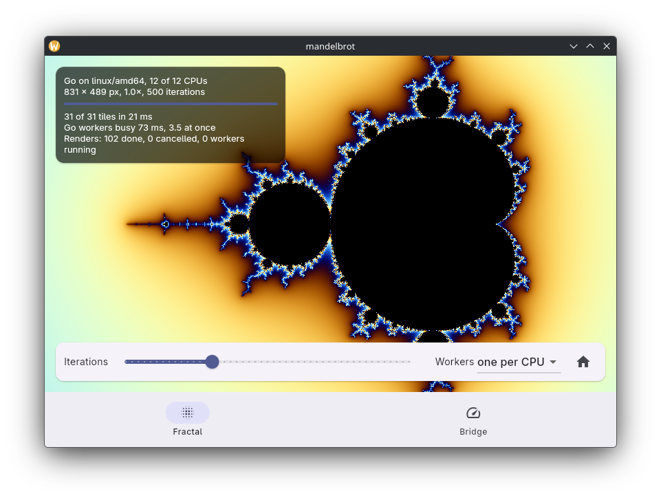

# mandelbrot



Heavy work in Go: the Mandelbrot set is rendered by one worker goroutine
per CPU and streamed to Flutter tile by tile, while the UI stays
responsive. Every change of the view cancels the running render, and the Go
workers stop. A second tab measures what the bridge itself costs. Created
with `fluffy create`.

```
golang/
  fractal/          the renderer, plain Go (go test ./fractal)
    yield_js.go     lets the browser run between tiles, see below
  bench/            Go methods that do nothing, for the benchmarks
  main.go           binds fractal.Renderer as "fractal" and bench.Bench as "bench"
lib/
  fractal.dart      FractalController: starts/cancels renders, assembles the image
  fractal_page.dart tap to zoom in, right click or long press to zoom out,
                    drag to move, mouse wheel to zoom
  bench.dart        the benchmarks, bench_page.dart shows them
test/               the controller against Bridge.fake() (receiver.stream plays Go)
integration_test/   real Go: full render, cancel stops the workers, zoom, benchmarks
```

```sh
fluffy run -d linux --release                     # or -d chrome
fvm flutter test
fvm flutter test integration_test -d linux        # benchmarks print at the end
(cd golang && go test -race ./...)
```

## How it works

`Renderer.Render(ctx, View) (<-chan Tile, error)` becomes
`Stream<Tile> golang.fractal.render(View)`. Workers take 16-row bands from
a queue, check `ctx` before every row and send finished tiles (RGBA bytes,
raw bytes on the wire) with a running `done`/`total` count. The controller
copies each tile into a frame buffer and decodes it into a `ui.Image`, at
most one decode at a time.

Starting a new render cancels the old subscription. fluffy cancels the Go
context, the workers stop after their current row, and `Stats` counts the
render as cancelled. The info card polls `golang.fractal.stats()`, so you
can watch "workers running" drop to 0 while you drag the iterations slider.

"Go workers busy … at once" is the time the workers spent on the tiles
divided by the wall time: how many CPUs the render really used.

### On the web

Go compiled to WebAssembly has one thread, the browser's main thread, and
only returns to the browser when every goroutine is blocked. A worker that
computes without blocking would freeze the page until the image is done,
because Flutter never gets to process a tile or draw a frame. `yield_js.go`
waits for a `MessageChannel` message after each tile, which hands the thread
back to the browser for about 0.05 ms. `time.Sleep(time.Millisecond)` would
do the same, but browsers stretch timeouts set from timeouts to 4 ms, which
adds up over hundreds of tiles. Natively `yield` does nothing. Any long
computation in Go on the web needs a pause like this, `fluffy.Yield()` is
the same for code that imports fluffy.

## What the bridge costs

The Bridge tab, and the end of the integration test, run the benchmarks.
Measured on Linux (profile build, 12 CPUs) and in Chromium (release build,
JavaScript):

| Benchmark | Linux | Web |
|-----------|-------|-----|
| Go → Dart, one way | median 11 µs | — (same thread) |
| isolate → main isolate, Dart only | median 1.06 ms | — |
| one call at a time | 25 µs | 0.14 ms |
| 10 000 calls in flight | 19 µs each | 92 µs each |
| Dart → Go 1 MiB | 2.5 GB/s | 0.8 GB/s |
| Dart → Go 16 MiB | 2.6 GB/s | 1.8 GB/s |
| Go → Dart 1 MiB | 0.54 GB/s | 0.59 GB/s |
| Go → Dart 16 MiB | 1.3 GB/s | 0.69 GB/s |
| stream values | 380 k/s | 120 k/s |
| stream 256 KiB chunks | 1.35 GB/s | 0.5–0.65 GB/s |

The Go → Dart byte benchmarks include filling the bytes in Go
(`bench.pattern`), which takes most of their time.

On Linux a message from Go waits about 1 ms before Dart handles it: a
message from another Dart isolate waits just as long, the Flutter Linux
embedder schedules work on its main thread that way. fluffy avoids the wait
for answers: Dart's send blocks for up to 250 µs until Go has answered, and
then takes the answer right away. Streams and events still wait, but every
message waiting is taken at once, so the wait limits latency, not
throughput. Bytes travel raw next to the JSON, without base64.
