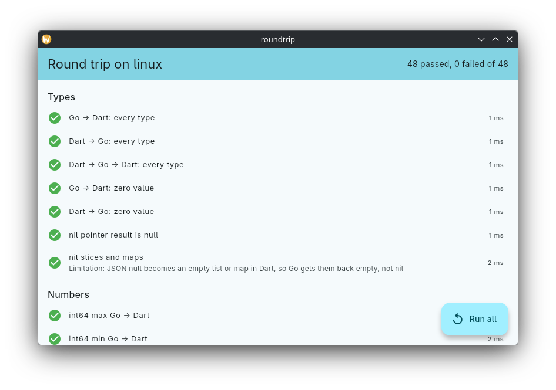

# roundtrip



Checks that values survive the trip between Dart and Go: every kind of type
the generator maps, the edge cases of JSON numbers, strings, bytes and
times, errors and panics, Go calling Dart, streams with cancel, and
concurrency. It runs against the real Go library and transport, on desktop
and on the web. Created with `fluffy create`.

The app runs all checks at start and lists the results. The same checks run
as an integration test, so this is also a regression test for fluffy
itself: after changing the templates or the generator, run `fluffy update`
here and the tests below.

```
golang/
  sample/           Everything: a field per kind of type, Want() its value
    diff.go         compares two Everything values field by field
    testdata/       want.json, Want() as Go encodes it (go test ./sample -update)
  api.go            //fluffy:export functions the checks call, Host (//fluffy:dart)
  fluffy_api.go     generated
lib/
  checks.dart       the checks, wantEverything() (the Dart twin of Want)
  main.dart         runs the checks and shows the results
test/               generated classes against want.json, without Go
integration_test/   every check against the real Go library
```

Each check compares on the receiving side: Go builds a value and Dart
compares it with what it expects, or Dart sends a value and Go reports what
arrived. An echo alone would hide a mistake made the same way in both
directions.

```sh
fluffy run -d linux                                   # or -d chrome
fvm flutter test                                      # decode/encode against want.json
fvm flutter test integration_test -d linux            # every check, real Go
(cd golang && go test ./...)

# web, with chromedriver --port=4444 running
fluffy lib web
CHROME_EXECUTABLE=$(which chromium) fvm flutter drive --release \
  --driver=test_driver/integration_test.dart \
  --target=integration_test/app_test.dart -d web-server --browser-name=chrome --headless
```

## Limitations the checks document

A check with a note passes when the value arrives the way the note says,
so a change in either direction shows up.

| Value | Native and WebAssembly | Web (JavaScript) |
|-------|------------------------|------------------|
| int64 beyond ±2^53 | exact | rounded, JavaScript numbers have 53 bits |
| uint64 above int64 max | the call fails (`double` is not `int`) | rounded |
| `-0.0` from Go | arrives as `0.0`, Dart parses `-0` as the int 0 | exact |
| `time.Time` | microseconds, the zone offset becomes UTC | same |
| `time.Duration` | microseconds | same, rounded above 2^53 ns |
| nil slices and maps | empty in Dart, so empty (not nil) back in Go | same |
| invalid UTF-8 from Go, lone surrogates from Dart | become U+FFFD | same |
| NaN and ±Inf | the call fails on the sending side | same |

`flutter drive --wasm` still ran the JavaScript build here, so the
WebAssembly column is what the checks expect from 64-bit Dart ints, not a
measured result.
