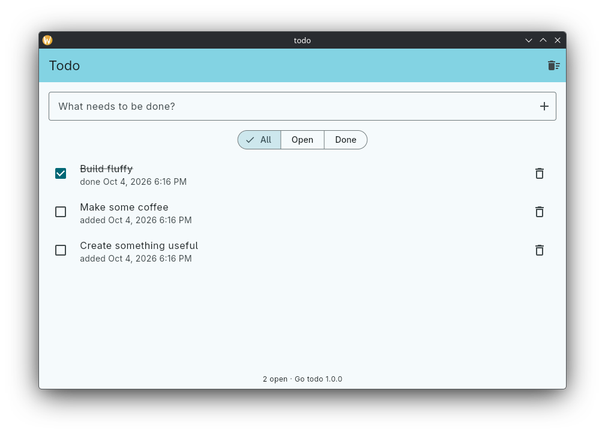

# todo_module



A todo app built on the fluffy service workflow: a Go service with state,
bound into Flutter with `fluffy.Start` / `fluffy.Bind`, with the Dart API
generated by `fluffy generate`. Created with `fluffy create`.

Unlike `test/todo`, where the service is the package `golang/todo/`, the
service here is a Go module of its own, as an existing Go app would be. The
generated Dart API is the same.

```
todo/               the service, module example.com/todo, plain Go without fluffy
  go.mod
  todo.go           Service, Item, and UI (//fluffy:dart, Go asks Dart)
  store.go          JSON file in the config dir (desktop, iOS, Android)
  store_js.go       localStorage (web)
golang/
  go.mod            require example.com/todo, replace => ../todo
  main.go           creates the service in fluffy.Start, binds it as "todo"
  fluffy_api.go     generated: newTodoUI()
lib/
  main.dart         the UI
  golang/api.g.dart generated: golang.todo.*, golang.Item, golang.TodoUI
```

The `replace` makes the Go tool build `../todo` from source, and
`fluffy generate` scans it because it is a local module: it finds the
methods of the bound `todo.Service`, the `//fluffy:dart` interface `todo.UI`
and the `//fluffy:export` function `todo.Version`. A `go.work` in the project
root that uses `./golang` and `./todo` works the same way.

`golang.todo.watch()` is a stream of the whole list, sent again after every
change. The UI answers `TodoUI.confirm` with a dialog when Go asks before
deleting the done items.

```sh
fluffy run -d linux                                   # or fluffy run -d chrome
(cd todo && go test ./...)                            # the service, without Flutter
fvm flutter test                                      # widget test against Bridge.fake()
XDG_CONFIG_HOME=$(mktemp -d) fvm flutter test integration_test -d linux   # against the real Go service
```

On desktop the list is `fluffy-todo/todos.json` in the user's config
directory, the same file `test/todo` uses.
